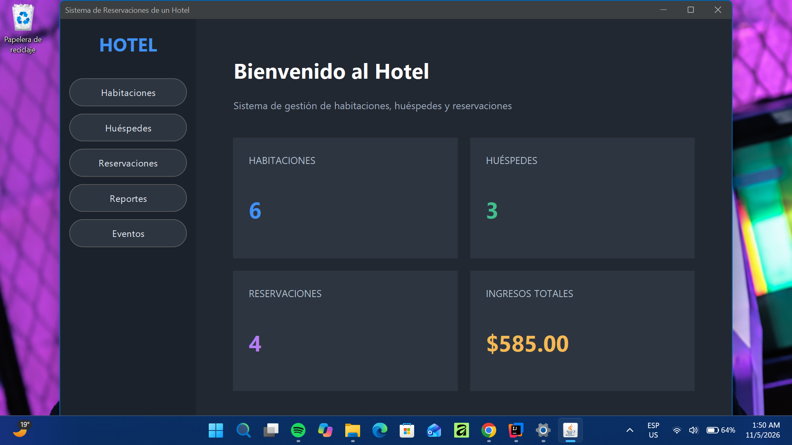
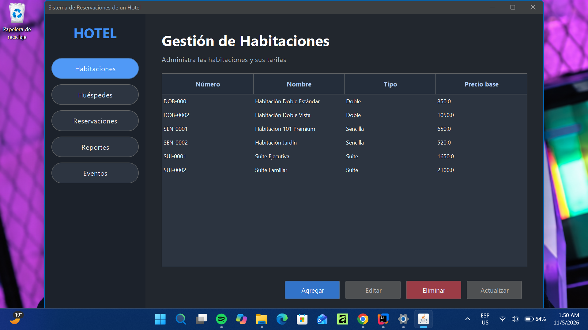
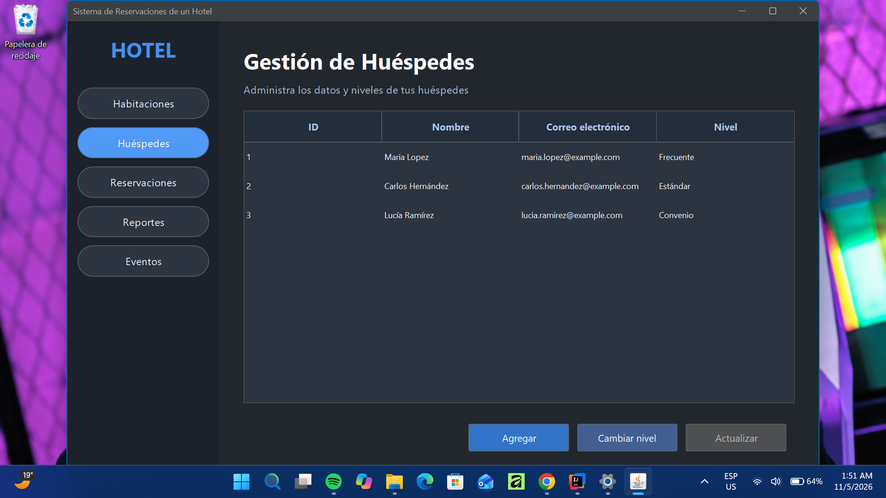
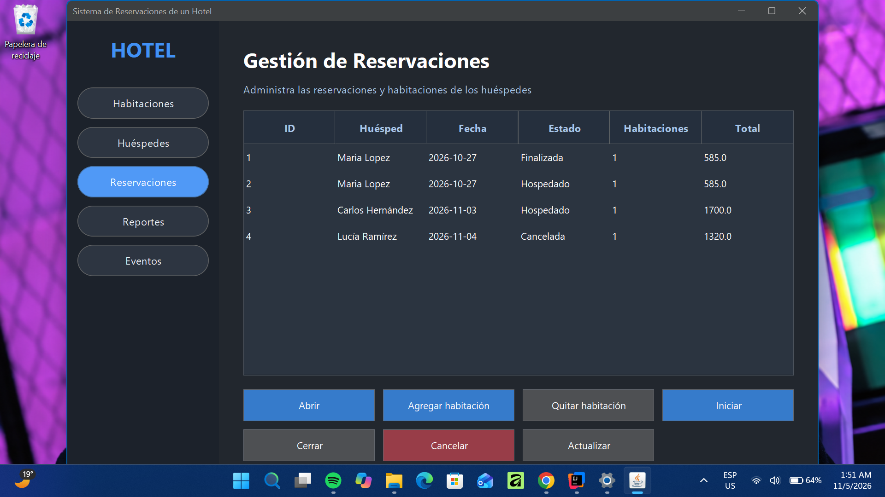
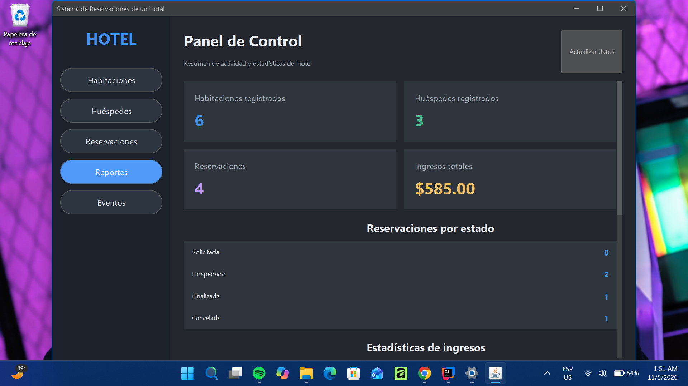
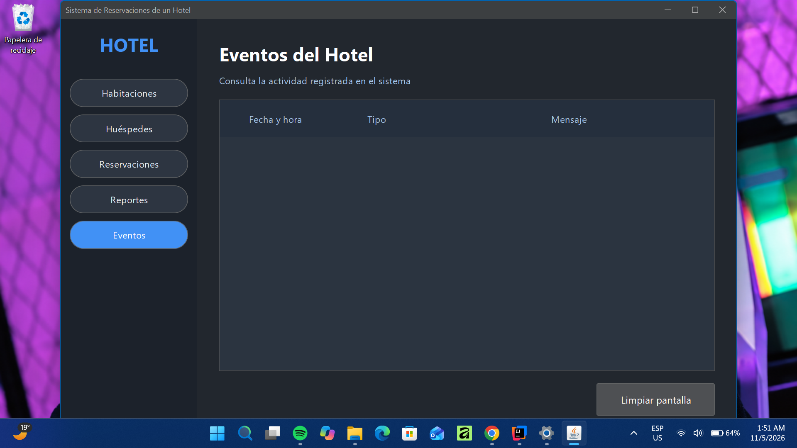

# 🏨 Sistema de Reservaciones de un Hotel

**Miniproyecto 5 · Java 21 · Maven · SQLite · Swing**

Aplicación de escritorio para administrar habitaciones, huéspedes y reservaciones de un hotel. El proyecto parte del esqueleto proporcionado para la asignatura y desarrolla el modelo orientado a objetos, la persistencia, los eventos, la concurrencia y los reportes.

## Funcionalidades

- **Habitaciones:** registro, consulta, actualización y eliminación; subtipos `Sencilla`, `Doble` y `Suite`.
- **Huéspedes:** registro, consulta y gestión de niveles (`ESTANDAR`, `FRECUENTE`, `CONVENIO`).
- **Reservaciones:** creación, asignación de habitaciones y gestión de estados (`ABIERTA`, `EN_CURSO`, `CERRADA`, `CANCELADA`).
- **Persistencia SQLite:** repositorios JDBC para habitaciones, huéspedes y reservaciones.
- **Interfaz Swing:** paneles de habitaciones, huéspedes, reservaciones, reportes y eventos.
- **Eventos:** notificaciones sobre altas, cambios de estado y alertas.
- **Concurrencia:** monitor periódico de reservaciones mediante `Runnable`, `Thread` y detención cooperativa.
- **Reportes:** ingresos por tipo, habitaciones más demandadas, mejores huéspedes, estadísticas y filtros con streams.
- **Respaldo:** exportación e importación de datos serializados.

## Tecnologías y requisitos

- **JDK 21**
- **Apache Maven**
- **SQLite** mediante `sqlite-jdbc 3.46.1.3`
- **Java Swing** y **FlatLaf 3.5.4** para la interfaz
- IDE recomendado: IntelliJ IDEA

Maven administra las dependencias declaradas en `pom.xml`.

## Estructura del proyecto

```text
P5_hotel/
├── src/main/java/mx/tecnm/orizaba/tp/hotel/
│   ├── app/           # Demostración y pruebas
│   ├── concurrencia/  # Tareas periódicas
│   ├── eventos/       # Publicación y recepción de eventos
│   ├── funcional/     # Reglas y fábricas funcionales
│   ├── modelo/        # Entidades y lógica de dominio
│   ├── persistencia/  # SQLite, repositorios y respaldos
│   ├── servicio/      # Fachada Hotel y monitor interno
│   └── ui/            # Interfaz gráfica Swing
├── diagramas/         # Diagramas UML en PlantUML
├── datos.db           # Base de datos de ejemplo
├── pom.xml
├── README.md
└── BITACORA_IA.md
```

## Compilar y ejecutar

Abre una terminal en la raíz del proyecto (donde está `pom.xml`).

**Compilar:**

```bash
mvn compile
```

**Ejecutar pruebas del modelo:**

```bash
mvn exec:java
```

**Ejecutar la demostración por consola:**

```bash
mvn exec:java -Pdemo
```

**Ejecutar la interfaz gráfica:**

En IntelliJ, ejecuta el método `main` de `mx.tecnm.orizaba.tp.hotel.ui.VentanaPrincipal`.

> El proyecto incluye `datos.db` como archivo de ejemplo. La base utilizada durante la ejecución depende de la ruta configurada por la aplicación; verifica esa ruta antes de modificar datos.

## Pruebas

Se ejecutó `mx.tecnm.orizaba.tp.hotel.app.PruebasModelo` y se obtuvo **14 de 14 pruebas aprobadas** durante la verificación final.

## Documentación Javadoc

Los comentarios Javadoc documentan las clases y los métodos públicos del proyecto. Para generar la documentación HTML:

```bash
mvn javadoc:javadoc
```

Después, abre `target/reports/apidocs/index.html` en el navegador (la ubicación puede variar según la configuración de Maven). La generación se verificó con **BUILD SUCCESS**.

## Diagramas y documentación adicional

- `diagramas/modelo_actualizado.png`: diagrama UML actualizado del modelo.
- `diagramas/modelo.puml`: diagrama incluido originalmente en el proyecto.
- `BITACORA_IA.md`: registro del uso de herramientas de inteligencia artificial durante el desarrollo.
- `README.md`: guía de instalación, ejecución y organización del proyecto.

## Diseño y conceptos aplicados

Se emplean **encapsulamiento, herencia, polimorfismo, interfaces, clases internas, genéricos, expresiones lambda, referencias a métodos, streams, excepciones, concurrencia y persistencia JDBC**. La clase `Hotel` actúa como fachada de servicios para la interfaz gráfica.

## Origen

Proyecto académico desarrollado a partir del esqueleto **«Miniproyecto 5: Sistema de Reservaciones de un Hotel»**. Para los requisitos de evaluación y la especificación completa, consultar el documento proporcionado por el docente.

## Capturas de pantalla del sistema

El Sistema de Reservaciones de un Hotel cuenta con una interfaz gráfica desarrollada en Java Swing, que permite gestionar habitaciones, huéspedes y reservaciones, además de consultar reportes y monitorear eventos del sistema.

### Pantalla de inicio

Ventana principal del sistema, desde la cual se puede acceder a los diferentes módulos.



### Gestión de habitaciones

Permite visualizar y administrar las habitaciones registradas, incluyendo sus características y precios.



### Gestión de huéspedes

Interfaz para consultar y administrar la información de los huéspedes del hotel.



### Gestión de reservaciones

Módulo para consultar y gestionar las reservaciones realizadas en el hotel.



### Reportes del sistema

Permite consultar información estadística y reportes relacionados con la operación del hotel.



### Monitor de eventos

Panel para visualizar los eventos generados durante el funcionamiento del sistema.



## Documentación Javadoc

La documentación de las clases y métodos del sistema fue generada
mediante Maven utilizando el comando:

`mvn javadoc:javadoc`

La documentación HTML está disponible en
[docs/javadoc/index.html](docs/javadoc/index.html).

Para consultarla, descarga el repositorio y abre
`docs/javadoc/index.html` en tu navegador.m